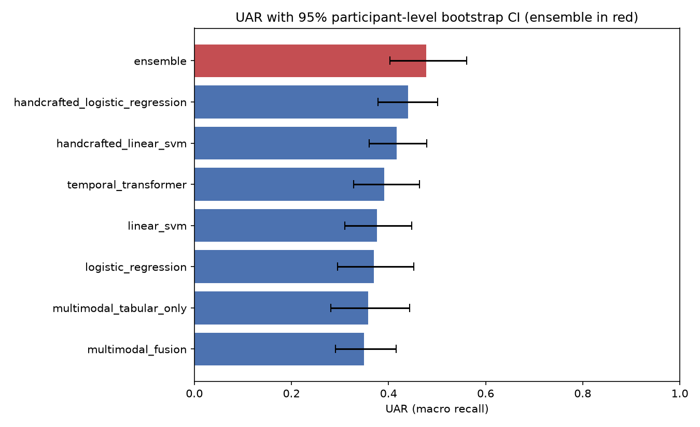

# 🚗 DriverStateNet

Detecting driver impairment (cognitive distraction, alcohol intoxication, or both) from
driving-simulator sensor and video data: gaze, steering, vehicle dynamics, and
front-camera frames, using [Toyota Research Institute's Impaired Driving Dataset
(IDD)](https://toyotaresearchinstitute.github.io/IDD/).

An ML case study comparing classical, transformer, and multimodal fusion models for driver-impairment detection on a small, imbalanced dataset, diagnosing why bigger models underperformed and fixing it to reach the project's first statistically significant result (UAR +0.10 over baseline, p=0.004).

This explains what was tried, what actually
worked, what didn't, and why. That includes a fix that took the project's only
statistically significant result from "doesn't exist" to "UAR +0.10 over baseline,
p=0.004".

## 🎯 The task

4-way classification of ~30s driving-scenario windows into `baseline`,
`cognitive_distraction`, `alcohol_intoxication`, or `combined`, evaluated with 5-fold
**participant-grouped** cross-validation (nobody's data appears in both train and test)
and reported as **UAR** (macro recall, which treats all 4 classes equally regardless of
their size).

| | |
|---|---|
| Scenario windows | 371 |
| Participants | 52 |
| Class sizes | baseline 148, cognitive_distraction 147, alcohol_intoxication 37, combined 39 |

The class imbalance and small participant count are the central constraint on
everything below. Most of this case study is about what that constraint does to model
selection, not about a particular architecture.

## 📊 Results

| Model | Features | UAR | 95% CI | vs. baseline |
|---|---|---:|---|---|
| logistic regression | 196 generic per-channel stats | 0.370 | [0.29, 0.45] | n/a |
| **linear SVM (naive baseline)** | 196 generic per-channel stats | **0.376** | [0.31, 0.45] | n/a |
| temporal transformer | 84 raw per-timestep channels | 0.391 | [0.33, 0.46] | +0.015, n.s. |
| multimodal (tabular-only) | 84 raw per-timestep channels | 0.358 | [0.28, 0.44] | -0.018, n.s. |
| multimodal (fusion, +video) | 84 channels + 8 video frames | 0.349 | [0.29, 0.42] | -0.027, n.s. |
| multimodal (video-only) | 8 video frames | 0.258 | n/a | -0.118, n.s. |
| handcrafted linear SVM | 10 hand-picked features | 0.417 | [0.36, 0.48] | +0.041, n.s. |
| **handcrafted logistic regression** | 10 hand-picked features | **0.440** | [0.38, 0.50] | ✅ **+0.064, p=0.025** |
| **ensemble** (handcrafted LR + handcrafted SVM + transformer + multimodal tabular) | mixed | **0.478** | [0.40, 0.56] | ✅ **+0.102, p=0.004** |

*CIs and p-values are a participant-level bootstrap (2000 resamples). See
[`artifacts/ensemble/bootstrap_ci.csv`](artifacts/ensemble/bootstrap_ci.csv) and
[`significance_vs_baseline.csv`](artifacts/ensemble/significance_vs_baseline.csv).
"n.s." means not statistically distinguishable from the baseline at this sample size.*



The ensemble is the only result in the project that clears statistical significance
against the naive baseline. It is *not* significantly better than the best single
model (handcrafted logistic regression) on its own: delta +0.038, p=0.213
([`significance_vs_best_single_model.csv`](artifacts/ensemble/significance_vs_best_single_model.csv)).
That's an honest, disclosed limit on how much the ensembling is really buying, not
a second headline claim.

## 🔍 What actually happened (three findings)

**1. 📉 More features hurt, at this sample size.** The same linear model, run twice: 196
generic per-channel statistics (mean/std/min/max/...) gets UAR 0.376; 10 hand-picked
domain features (gaze std, pupil diameter, steering-reversal rate, longitudinal accel)
gets UAR 0.440
([`handcrafted_baseline/model_comparison.csv`](artifacts/handcrafted_baseline/model_comparison.csv)
vs.
[`logreg_baseline/model_comparison.csv`](artifacts/logreg_baseline/model_comparison.csv)).
With ~290 training rows per fold, feature selection did more for accuracy than
switching model families did.

**2. ⚖️ A weighted oversampler was quietly making the temporal transformer worse.** The
first pass at the transformer used focal loss *and* a per-batch class-weighted sampler
to fight the 148-vs-37 class imbalance: the standard playbook. It scored UAR 0.325,
*below* every classical baseline. A hyperparameter sweep
([`sweep_results.csv`](artifacts/temporal_transformer/sweep_results.csv)) isolated the
cause: with ~220 training rows per fold, oversampling ~35 minority rows up to parity
means the model sees the same handful of examples many times per epoch and overfits to
them. Recall on the minority classes went up, but precision collapsed. Removing the
sampler (plain class-weighted cross-entropy, same architecture) recovered UAR to 0.391.
Model *capacity* (dimension, layers) turned out not to be the lever; smaller models in
the sweep didn't do better. The same fix did **not** transfer to the multimodal model:
its sampler sensitivity went the other way in a matched sweep
([`sweep_tabular_only_round2.csv`](artifacts/multimodal_fusion/sweep_tabular_only_round2.csv)).
That's itself the more important lesson: there wasn't a universal "imbalance fix",
only a diagnosis that had to be redone per architecture. See the config comments in
[`notebooks/03_temporal_transformer.ipynb`](notebooks/03_temporal_transformer.ipynb) and
[`notebooks/04_multimodal.ipynb`](notebooks/04_multimodal.ipynb) for the full sweep
results and reasoning.

**3. 🧩 The ensemble was silently excluding its own best model.** The original ensembling
notebook hardcoded four components (`linear_svm + temporal_transformer +
multimodal_tabular_only + multimodal_fusion`) and never included the
`handcrafted_baseline` models, even though handcrafted logistic regression was
already the best single model in the project. Under the *original* (untuned) deep-model
configs, that ensemble scored UAR 0.403, not significantly better than baseline
(p=0.334,
[`artifacts/ensemble_v1_excludes_handcrafted/summary.csv`](artifacts/ensemble_v1_excludes_handcrafted/summary.csv)).
Re-running that same four-component set with the tuned deep models from finding #2 only
gets to 0.416, so most of the 0.403 -> 0.478 improvement is the missing handcrafted
models, not the deep-model tuning. Comparing candidate component sets by CV UAR
([`ensemble_component_set_comparison.csv`](artifacts/ensemble/ensemble_component_set_comparison.csv))
confirms this directly: adding the handcrafted models to the tuned four-model set is
the single biggest lever (0.416 -> 0.478), and throwing *every* available model into the
ensemble (0.420) was worse than the curated four-model subset. More models is not
automatically better.

## 🧪 Method

- **Cross-validation**: 5 fixed folds, split by participant (`fixed_fold` in
  `src/data_bootstrap.py`) so the same person's scenarios never appear in both train and
  test.
- **Classical baselines** (`notebooks/02_generic_baseline.ipynb`,
  `02b_handcrafted_baseline.ipynb`): logistic regression / linear SVM over either 196
  generic per-window statistics or 10 hand-picked domain features, via
  `src/classical_baseline.py`.
- **Temporal transformer** (`notebooks/03_temporal_transformer.ipynb`): a small
  Transformer encoder (`src/temporal_transformer.py`) over the raw per-timestep
  tabular signal (gaze, vehicle dynamics), no video.
- **Multimodal fusion** (`notebooks/04_multimodal.ipynb`): the same tabular encoder
  plus a frozen ImageNet-pretrained ResNet-18 frame encoder and cross-modal attention
  (`src/multimodal_fusion.py`), with `tabular_only` / `video_only` / `fusion` ablations.
- **Ensembling and statistics** (`notebooks/05_ensemble_and_significance.ipynb`): soft
  probability voting (`src/evaluation.py::soft_vote_ensemble`) plus participant-level
  bootstrap confidence intervals and paired significance tests
  (`bootstrap_uar_ci`, `paired_bootstrap_delta`), because at n=371/52 participants, a
  point-estimate UAR on its own isn't enough to claim one model beats another.

A caveat worth stating plainly: hyperparameter configs for the deep models were chosen
by their own 5-fold mean UAR (no separate held-out tuning set; the dataset is too
small to spare one). That's a standard compromise at this scale, but it means the
reported deep-model numbers carry slightly more optimism than a fully nested
cross-validation would.

## 🚀 What I'd do differently with more time or data

- **👥 More participants is the real fix.** No architecture change gets around ~290
  training rows for a 4-way imbalanced problem; everything above is squeezing signal
  out of a dataset that's fundamentally too small for the deep models it's being asked
  to support.
- **🎥 The video branch needs real data or a different objective.** Video-only scores
  near chance even with a frozen ImageNet backbone. ~300 clips isn't enough to learn a
  useful driver-state signal from pixels. Worth trying either a task-specific
  pretraining objective (e.g. gaze/landmark prediction) or dropping the from-scratch
  video branch entirely in favor of an off-the-shelf face/gaze estimator's outputs as
  additional handcrafted features.
- **🎯 Target `alcohol_intoxication` and `combined` directly.** They're the hardest and
  smallest classes across every model (F1 0.20 to 0.33,
  [`ensemble_per_class_report.csv`](artifacts/ensemble/ensemble_per_class_report.csv)).
  A binary "any impairment" reformulation would be a more stable target at this
  sample size than 4-way classification.

## ▶️ Demo

The best single model (handcrafted logistic regression, fit on all folds) is served
two ways, both backed by the same `predict()` function
(`scripts/predict.py`) so they can't drift apart:

```bash
pip install -r requirements.txt
python scripts/fit_final_model.py        # fits + saves artifacts/handcrafted_baseline/final_model.joblib

# CLI
python scripts/predict.py --input examples/sample_windows.csv

# API
uvicorn app.main:app --reload
curl -X POST http://127.0.0.1:8000/predict -H "Content-Type: application/json" -d '{
  "gaze_fixation_change_rate": 230.0, "gaze_pitch_std": 4.2, "gaze_saccade_change_rate": 55.0,
  "gaze_yaw_std": 6.1, "longitudinal_acceleration_neg_mean": -0.8, "longitudinal_acceleration_pos_mean": 0.6,
  "longitudinal_speed_pos_mean": 8.5, "reversals_0_5_sum_rate": 3.1, "reversals_2_5_sum_rate": 0.4,
  "tobii_eye_pupil_diameter_mean": 3.9
}'
```

Note this demo model is fit on *all* folds (no held-out set), so its expected
real-world performance is the cross-validated number above (UAR 0.440), not whatever it
scores on data it has already seen.

## 🔁 Reproducing

This repo ships the code and the *aggregate* results (metrics, confusion matrices,
bootstrap CIs, figures), not the raw dataset or row-level predictions, which carry
per-participant identifiers and intoxication labels. See
[`data/README.md`](data/README.md) for what that means and how to rebuild from raw
IDD data if you have access to it.

```bash
python -m venv .venv
.venv\Scripts\Activate.ps1          # Windows; use `source .venv/bin/activate` on macOS/Linux
pip install -r requirements-dev.txt
pytest tests/ -q                    # unit tests, no dataset required
jupyter lab                         # open notebooks/ to rerun the full pipeline
```

`torch`/`torchvision` in `requirements.txt` are the CPU wheels. For GPU training,
install the matching CUDA build for your setup instead, e.g.:
```bash
pip install --index-url https://download.pytorch.org/whl/cu128 torch torchvision
```

## 🔬 Follow-up study: session order in IDD

A follow-up analysis asks how much of the alcohol signal in IDD is session change.
In IDD, the alcohol cohort drives sober first and intoxicated second, and a separate
control cohort drives both sessions sober. The study uses a pre-hazard window and
participant-level mixed models (cohort × session × cognitive distraction), and it checks
whether classifiers flag sober drivers from the alcohol cohort more often. The plan and
deviations log are in [`docs/HYPOTHESES.md`](docs/HYPOTHESES.md). All aggregate results
are in [`artifacts/study/RESULTS.md`](artifacts/study/RESULTS.md).

```bash
python -m scripts.study.build_features        # trip audit + window features (needs data/IDD and dataset/)
python -m scripts.study.run_analyses          # pre-specified models, diagnostics, classification by window
python -m scripts.study.run_model_comparison  # LR / SVM / GBM / transformer, nested CV
python -m scripts.study.run_novelty           # post hoc additions (27-28 Oct 2026)
python -m scripts.study.run_revision          # main full-factorial model, sensitivity, bootstraps
python -m scripts.study.figures
python -m scripts.study.report                # writes artifacts/study/RESULTS.md
python -m scripts.study.record_provenance
```

Row-level tables and predictions are written to `artifacts/study/private/`. That folder is
gitignored because it holds participant IDs and intoxication labels.

## 📁 Project structure

```
src/                  reusable pipeline code (data loading, models, evaluation)
src/study/            follow-up study: trip audit, window features, mixed models, nested CV
notebooks/            01 download -> 02/02b baselines -> 03 transformer -> 04 multimodal -> 05 ensemble
artifacts/             metrics, figures, and confusion matrices produced by the notebooks
artifacts/study/      follow-up study: aggregate results, audit tables, figures, RESULTS.md
scripts/               fit_final_model.py, predict.py (CLI demo)
scripts/study/        follow-up study pipeline (see above)
app/                    FastAPI demo (`uvicorn app.main:app`)
tests/                  unit tests for src/evaluation.py, src/classical_baseline.py, src/study/, and the API
docs/HYPOTHESES.md      follow-up study: analysis plan and deviations log
data/README.md          dataset provenance and how to reproduce from raw IDD data
```
