# IDD session-order study: results

*Generated by `scripts/study/report.py` from `artifacts/study/results/` and `artifacts/study/audit/`. Pre-specified plan: `docs/HYPOTHESES.md`. Sections 2–11 use the pre-specified constrained model; the main analysis since the revision (full cohort × session × CD model) is in Section 12.*

## 1. Trip audit

Study participants (52); trips by exclusion reason and label:

| exclusion_reason                                  |   baseline |   cognitive_distraction |   alcohol_intoxication |   combined |
|:--------------------------------------------------|-----------:|------------------------:|-----------------------:|-----------:|
| included                                          |        148 |                     147 |                     37 |         39 |
| simulator anomaly (DBM scenario_remove_anomalies) |         20 |                      21 |                      3 |          1 |

TRI-feature reproduction check on the course-report window: worst-feature correlation 0.9998 over 371 trips.

## 2. Behavioural effects (H1–H3, H5): linear mixed models

Coefficients in SD units of sober Round-1 no-task trips, with 95% CI. `alcohol` = additional R1→R2 change in the alcohol arm beyond the control arm's R1→R2 change; `round2` = session-order effect estimated from both arms. Bold \* = Holm-adjusted p < 0.05 within each term. Model: `z ~ cohort_v1 + round2 + alcohol + cd + alcohol:cd + C(scenario) + (1|participant)`.

### Primary window: pre90 ([−120 s, −30 s] before scenario end)

| Measure | cd | alcohol | alcohol:cd | round2 | ICC |
|---|---|---|---|---|---|
| gaze_yaw_sd | -0.25 [-0.43, -0.07] | -0.72 [-1.10, -0.33] **\*** | +0.15 [-0.25, +0.55] | +0.32 [+0.11, +0.53] **\*** | 0.29 |
| gaze_pitch_sd | -0.88 [-1.09, -0.68] **\*** | -0.16 [-0.59, +0.27] | +0.34 [-0.10, +0.79] | -0.14 [-0.37, +0.10] | 0.28 |
| prc | +0.48 [+0.31, +0.65] **\*** | +0.63 [+0.27, +1.00] **\*** | -0.31 [-0.68, +0.07] | -0.16 [-0.36, +0.03] | 0.25 |
| fixation_rate | -0.61 [-0.77, -0.45] **\*** | -1.04 [-1.37, -0.70] **\*** | +0.14 [-0.21, +0.48] | -0.04 [-0.22, +0.14] | 0.54 |
| saccade_rate | -0.32 [-0.43, -0.21] **\*** | -0.72 [-0.96, -0.48] **\*** | +0.07 [-0.17, +0.32] | -0.03 [-0.16, +0.10] | 0.73 |
| pupil_mean | +0.16 [+0.10, +0.22] **\*** | +0.18 [+0.06, +0.31] **\*** | +0.09 [-0.04, +0.22] | -0.19 [-0.25, -0.12] **\*** | 0.92 |
| steer_hf_sd_straight | -0.04 [-0.28, +0.21] | +0.24 [-0.28, +0.77] | -0.19 [-0.73, +0.36] | +0.24 [-0.04, +0.53] | 0.10 |
| lateral_dev_sd_straight | -0.22 [-0.44, -0.01] | +0.60 [+0.14, +1.06] | +0.03 [-0.45, +0.51] | +0.02 [-0.24, +0.27] | 0.41 |
| steer_angle_sd | +0.20 [-0.33, +0.73] | +0.24 [-0.88, +1.36] | -0.45 [-1.61, +0.70] | +0.56 [-0.05, +1.17] | 0.00 |
| reversals_0_5 | +0.14 [-0.02, +0.30] | +0.60 [+0.26, +0.94] **\*** | -0.07 [-0.43, +0.28] | +0.06 [-0.13, +0.24] | 0.24 |
| reversals_2_5 | -0.06 [-0.27, +0.14] | +0.51 [+0.07, +0.95] | -0.15 [-0.60, +0.31] | +0.12 [-0.12, +0.36] | 0.18 |
| lat_accel_sd | -0.03 [-0.18, +0.13] | +0.20 [-0.13, +0.53] | +0.16 [-0.18, +0.50] | +0.17 [-0.01, +0.35] | 0.19 |
| speed_mean | -0.07 [-0.26, +0.13] | +0.04 [-0.37, +0.45] | +0.27 [-0.15, +0.69] | +0.11 [-0.12, +0.33] | 0.16 |
| speed_sd | -0.24 [-0.41, -0.07] **\*** | +0.09 [-0.28, +0.45] | +0.24 [-0.13, +0.62] | +0.02 [-0.18, +0.22] | 0.28 |
| gaze_valid_frac | -0.56 [-0.73, -0.40] **\*** | +0.45 [+0.09, +0.80] | -0.01 [-0.38, +0.36] | -0.33 [-0.52, -0.13] **\*** | 0.75 |

### Hazard window: haz30 (last 30 s), for comparison

| Measure | cd | alcohol | alcohol:cd | round2 | ICC |
|---|---|---|---|---|---|
| gaze_yaw_sd | -0.32 [-0.45, -0.19] **\*** | -0.49 [-0.77, -0.21] **\*** | +0.19 [-0.10, +0.48] | +0.23 [+0.08, +0.38] **\*** | 0.00 |
| gaze_pitch_sd | -0.77 [-0.95, -0.59] **\*** | -0.23 [-0.61, +0.15] | +0.16 [-0.24, +0.56] | -0.16 [-0.37, +0.05] | 0.19 |
| prc | +0.42 [+0.27, +0.57] **\*** | +0.36 [+0.04, +0.68] | -0.04 [-0.37, +0.29] | -0.21 [-0.38, -0.04] | 0.00 |
| fixation_rate | -0.67 [-0.83, -0.51] **\*** | -0.96 [-1.31, -0.61] **\*** | +0.17 [-0.19, +0.53] | +0.06 [-0.13, +0.25] | 0.19 |
| saccade_rate | -0.46 [-0.60, -0.31] **\*** | -0.77 [-1.08, -0.46] **\*** | +0.27 [-0.05, +0.58] | +0.04 [-0.13, +0.21] | 0.53 |
| pupil_mean | +0.09 [+0.03, +0.15] **\*** | +0.08 [-0.05, +0.20] | +0.10 [-0.03, +0.23] | -0.15 [-0.21, -0.08] **\*** | 0.89 |
| steer_hf_sd_straight | +0.08 [-0.11, +0.27] | +0.23 [-0.18, +0.63] | -0.03 [-0.46, +0.39] | +0.14 [-0.08, +0.37] | 0.06 |
| lateral_dev_sd_straight | -0.09 [-0.24, +0.05] | +0.13 [-0.18, +0.44] | -0.09 [-0.41, +0.24] | +0.12 [-0.05, +0.29] | 0.02 |
| steer_angle_sd | -0.06 [-0.16, +0.05] | -0.08 [-0.31, +0.14] | +0.08 [-0.16, +0.31] | +0.08 [-0.04, +0.21] | 0.00 |
| reversals_0_5 | +0.03 [-0.17, +0.23] | +0.90 [+0.48, +1.33] **\*** | -0.31 [-0.75, +0.12] | -0.09 [-0.32, +0.14] | 0.17 |
| reversals_2_5 | -0.10 [-0.22, +0.03] | +0.21 [-0.06, +0.47] | +0.02 [-0.25, +0.29] | +0.01 [-0.14, +0.15] | 0.00 |
| lat_accel_sd | -0.02 [-0.14, +0.10] | -0.10 [-0.35, +0.16] | +0.00 [-0.26, +0.26] | +0.11 [-0.03, +0.25] | 0.01 |
| speed_mean | +0.06 [-0.05, +0.17] | +0.26 [+0.02, +0.50] | -0.12 [-0.37, +0.13] | +0.06 [-0.08, +0.19] | 0.04 |
| speed_sd | -0.15 [-0.35, +0.04] | -0.01 [-0.43, +0.42] | +0.30 [-0.14, +0.73] | +0.23 [-0.00, +0.46] | 0.14 |
| gaze_valid_frac | -0.52 [-0.76, -0.28] **\*** | +0.09 [-0.43, +0.60] | +0.30 [-0.24, +0.83] | -0.15 [-0.43, +0.13] | 0.53 |

## 3. Session-order and cohort diagnostics (H5), pre90, TRI features, nested CV

| analysis                                                    |   uar |   ci_low |   ci_high |   n_trips |   n_participants |
|:------------------------------------------------------------|------:|---------:|----------:|----------:|-----------------:|
| order_only: R2 vs R1 within control arm (v2)                | 0.608 |    0.56  |     0.658 |       222 |               32 |
| cohort_only: v1 vs v2 within R1 (no alcohol)                | 0.643 |    0.519 |     0.767 |       173 |               52 |
| alcohol arm: R2 (drunk) vs R1 (sober) within v1, TRI-style  | 0.665 |    0.618 |     0.714 |       149 |               20 |
| transfer: order model trained on v2, applied to v1 R2 vs R1 | 0.514 |    0.435 |     0.592 |       149 |               20 |

## 4. Classification by window (H4), TRI features, nested CV

| task         | window   |   uar |   ci_low |   ci_high |   recall__baseline |   recall__cognitive_distraction |   recall__alcohol_intoxication |   recall__combined |   recall__no_cd |   recall__cd |   recall__sober |   recall__intoxicated |
|:-------------|:---------|------:|---------:|----------:|-------------------:|--------------------------------:|-------------------------------:|-------------------:|----------------:|-------------:|----------------:|----------------------:|
| four_class   | pre90    | 0.429 |    0.37  |     0.489 |              0.615 |                           0.422 |                          0.243 |              0.436 |         nan     |      nan     |         nan     |               nan     |
| cd_binary    | pre90    | 0.652 |    0.611 |     0.696 |            nan     |                         nan     |                        nan     |            nan     |           0.659 |        0.645 |         nan     |               nan     |
| intox_binary | pre90    | 0.706 |    0.623 |     0.784 |            nan     |                         nan     |                        nan     |            nan     |         nan     |      nan     |           0.78  |                 0.632 |
| four_class   | pre30    | 0.468 |    0.404 |     0.541 |              0.554 |                           0.476 |                          0.432 |              0.41  |         nan     |      nan     |         nan     |               nan     |
| cd_binary    | pre30    | 0.679 |    0.634 |     0.726 |            nan     |                         nan     |                        nan     |            nan     |           0.692 |        0.667 |         nan     |               nan     |
| intox_binary | pre30    | 0.72  |    0.646 |     0.791 |            nan     |                         nan     |                        nan     |            nan     |         nan     |      nan     |           0.742 |                 0.697 |
| four_class   | haz30    | 0.406 |    0.342 |     0.471 |              0.622 |                           0.401 |                          0.243 |              0.359 |         nan     |      nan     |         nan     |               nan     |
| cd_binary    | haz30    | 0.666 |    0.621 |     0.71  |            nan     |                         nan     |                        nan     |            nan     |           0.654 |        0.677 |         nan     |               nan     |
| intox_binary | haz30    | 0.719 |    0.641 |     0.793 |            nan     |                         nan     |                        nan     |            nan     |         nan     |      nan     |           0.766 |                 0.671 |

Paired participant-bootstrap comparisons (same trips):

| task         | model_a   | model_b   |   uar_a |   uar_b |   delta |   ci_low |   ci_high |   p_value |
|:-------------|:----------|:----------|--------:|--------:|--------:|---------:|----------:|----------:|
| four_class   | haz30     | pre30     |   0.406 |   0.468 |  -0.062 |   -0.121 |    -0.005 |     0.034 |
| four_class   | pre90     | pre30     |   0.429 |   0.468 |  -0.039 |   -0.102 |     0.02  |     0.205 |
| four_class   | haz30     | pre90     |   0.406 |   0.429 |  -0.023 |   -0.083 |     0.032 |     0.434 |
| cd_binary    | haz30     | pre30     |   0.666 |   0.679 |  -0.014 |   -0.07  |     0.051 |     0.638 |
| cd_binary    | pre90     | pre30     |   0.652 |   0.679 |  -0.027 |   -0.075 |     0.023 |     0.29  |
| cd_binary    | haz30     | pre90     |   0.666 |   0.652 |   0.013 |   -0.041 |     0.063 |     0.589 |
| intox_binary | haz30     | pre30     |   0.719 |   0.72  |  -0.001 |   -0.061 |     0.059 |     0.953 |
| intox_binary | pre90     | pre30     |   0.706 |   0.72  |  -0.014 |   -0.073 |     0.038 |     0.612 |
| intox_binary | haz30     | pre90     |   0.719 |   0.706 |   0.013 |   -0.043 |     0.08  |     0.722 |

## 5. Robustness of behavioural effects

Estimate (SD units) per analysis variant; \* = Holm-adjusted p < 0.05 within term and variant.

|                                      | + gaze validity covariate   | + random slope for CD   | PRC around per-driver centre   | keep trips whose anomaly is outside the window   | pre30 window   | primary (pre90)   |
|:-------------------------------------|:----------------------------|:------------------------|:-------------------------------|:-------------------------------------------------|:---------------|:------------------|
| fixation_rate · alcohol              | -1.15\*                     | -1.09\*                 | nan                            | -1.04\*                                          | -0.81\*        | -1.04\*           |
| fixation_rate · alcohol:cd           | +0.14                       | +0.23                   | nan                            | +0.14                                            | +0.17          | +0.14             |
| fixation_rate · cd                   | -0.46\*                     | -0.63\*                 | nan                            | -0.61\*                                          | -0.45\*        | -0.61\*           |
| fixation_rate · round2               | +0.05                       | -0.04                   | nan                            | -0.04                                            | +0.15          | -0.04             |
| gaze_pitch_sd · alcohol              | -0.10                       | -0.17                   | nan                            | -0.16                                            | -0.08          | -0.16             |
| gaze_pitch_sd · alcohol:cd           | +0.34                       | +0.38                   | nan                            | +0.34                                            | +0.22          | +0.34             |
| gaze_pitch_sd · cd                   | -0.96\*                     | -0.89\*                 | nan                            | -0.88\*                                          | -0.70\*        | -0.88\*           |
| gaze_pitch_sd · round2               | -0.18                       | -0.14                   | nan                            | -0.14                                            | -0.16          | -0.14             |
| gaze_valid_frac · alcohol            | nan                         | +0.31                   | nan                            | +0.45                                            | +0.54          | +0.45             |
| gaze_valid_frac · alcohol:cd         | nan                         | +0.17                   | nan                            | -0.01                                            | -0.16          | -0.01             |
| gaze_valid_frac · cd                 | nan                         | -0.60\*                 | nan                            | -0.56\*                                          | -0.72\*        | -0.56\*           |
| gaze_valid_frac · round2             | nan                         | -0.33\*                 | nan                            | -0.33\*                                          | -0.35          | -0.33\*           |
| gaze_yaw_sd · alcohol                | -0.69\*                     | -0.72\*                 | nan                            | -0.72\*                                          | -0.55          | -0.72\*           |
| gaze_yaw_sd · alcohol:cd             | +0.15                       | +0.16                   | nan                            | +0.15                                            | +0.27          | +0.15             |
| gaze_yaw_sd · cd                     | -0.29\*                     | -0.25                   | nan                            | -0.25                                            | -0.20          | -0.25             |
| gaze_yaw_sd · round2                 | +0.30                       | +0.32\*                 | nan                            | +0.32\*                                          | +0.24          | +0.32\*           |
| lat_accel_sd · alcohol               | +0.17                       | +0.20                   | nan                            | +0.26                                            | +0.40          | +0.20             |
| lat_accel_sd · alcohol:cd            | +0.16                       | +0.16                   | nan                            | +0.08                                            | -0.01          | +0.16             |
| lat_accel_sd · cd                    | +0.01                       | -0.03                   | nan                            | -0.04                                            | +0.07          | -0.03             |
| lat_accel_sd · round2                | +0.20                       | +0.18                   | nan                            | +0.18                                            | +0.20          | +0.17             |
| lateral_dev_sd_straight · alcohol    | +0.61                       | +0.60                   | nan                            | +0.58                                            | +0.48          | +0.60             |
| lateral_dev_sd_straight · alcohol:cd | +0.03                       | +0.04                   | nan                            | +0.02                                            | -0.06          | +0.03             |
| lateral_dev_sd_straight · cd         | -0.23                       | -0.22                   | nan                            | -0.20                                            | -0.26          | -0.22             |
| lateral_dev_sd_straight · round2     | +0.01                       | +0.01                   | nan                            | -0.02                                            | +0.07          | +0.02             |
| prc · alcohol                        | +0.59\*                     | +0.65\*                 | nan                            | +0.63\*                                          | +0.51          | +0.63\*           |
| prc · alcohol:cd                     | -0.31                       | -0.33                   | nan                            | -0.31                                            | -0.35          | -0.31             |
| prc · cd                             | +0.54\*                     | +0.49\*                 | nan                            | +0.48\*                                          | +0.43\*        | +0.48\*           |
| prc · round2                         | -0.13                       | -0.17                   | nan                            | -0.16                                            | -0.18          | -0.16             |
| prc_driver · alcohol                 | nan                         | nan                     | +0.42                          | nan                                              | nan            | nan               |
| prc_driver · alcohol:cd              | nan                         | nan                     | -0.10                          | nan                                              | nan            | nan               |
| prc_driver · cd                      | nan                         | nan                     | +0.39\*                        | nan                                              | nan            | nan               |
| prc_driver · round2                  | nan                         | nan                     | -0.17                          | nan                                              | nan            | nan               |
| pupil_mean · alcohol                 | +0.19\*                     | +0.18\*                 | nan                            | +0.16                                            | +0.14          | +0.18\*           |
| pupil_mean · alcohol:cd              | +0.09                       | +0.09                   | nan                            | +0.10                                            | +0.13          | +0.09             |
| pupil_mean · cd                      | +0.16\*                     | +0.16\*                 | nan                            | +0.15\*                                          | +0.15\*        | +0.16\*           |
| pupil_mean · round2                  | -0.19\*                     | -0.19\*                 | nan                            | -0.17\*                                          | -0.16\*        | -0.19\*           |
| reversals_0_5 · alcohol              | +0.64\*                     | +0.60\*                 | nan                            | +0.56\*                                          | +0.50          | +0.60\*           |
| reversals_0_5 · alcohol:cd           | -0.07                       | -0.08                   | nan                            | -0.03                                            | -0.04          | -0.07             |
| reversals_0_5 · cd                   | +0.09                       | +0.14                   | nan                            | +0.13                                            | +0.24          | +0.14             |
| reversals_0_5 · round2               | +0.03                       | +0.06                   | nan                            | +0.05                                            | +0.04          | +0.06             |
| reversals_2_5 · alcohol              | +0.55                       | +0.50                   | nan                            | +0.49                                            | +0.51          | +0.51             |
| reversals_2_5 · alcohol:cd           | -0.15                       | -0.15                   | nan                            | -0.13                                            | -0.10          | -0.15             |
| reversals_2_5 · cd                   | -0.12                       | -0.06                   | nan                            | -0.06                                            | +0.13          | -0.06             |
| reversals_2_5 · round2               | +0.09                       | +0.13                   | nan                            | +0.12                                            | +0.11          | +0.12             |
| saccade_rate · alcohol               | -0.79\*                     | -0.75\*                 | nan                            | -0.72\*                                          | -0.68\*        | -0.72\*           |
| saccade_rate · alcohol:cd            | +0.07                       | +0.13                   | nan                            | +0.07                                            | +0.07          | +0.07             |
| saccade_rate · cd                    | -0.24\*                     | -0.33\*                 | nan                            | -0.32\*                                          | -0.31\*        | -0.32\*           |
| saccade_rate · round2                | +0.02                       | -0.03                   | nan                            | -0.03                                            | +0.02          | -0.03             |
| speed_mean · alcohol                 | +0.01                       | +0.04                   | nan                            | +0.12                                            | +0.16          | +0.04             |
| speed_mean · alcohol:cd              | +0.27                       | +0.27                   | nan                            | +0.18                                            | -0.02          | +0.27             |
| speed_mean · cd                      | -0.01                       | -0.06                   | nan                            | -0.07                                            | -0.03          | -0.07             |
| speed_mean · round2                  | +0.14                       | +0.11                   | nan                            | +0.09                                            | +0.06          | +0.11             |
| speed_sd · alcohol                   | +0.08                       | +0.08                   | nan                            | +0.11                                            | +0.36          | +0.09             |
| speed_sd · alcohol:cd                | +0.24                       | +0.25                   | nan                            | +0.21                                            | +0.21          | +0.24             |
| speed_sd · cd                        | -0.24                       | -0.24                   | nan                            | -0.24\*                                          | -0.35\*        | -0.24\*           |
| speed_sd · round2                    | +0.03                       | +0.03                   | nan                            | +0.02                                            | -0.03          | +0.02             |
| steer_angle_sd · alcohol             | +0.35                       | +0.16                   | nan                            | +0.26                                            | +0.05          | +0.24             |
| steer_angle_sd · alcohol:cd          | -0.44                       | -0.42                   | nan                            | -0.44                                            | -0.14          | -0.45             |
| steer_angle_sd · cd                  | +0.04                       | +0.18                   | nan                            | +0.21                                            | +0.34          | +0.20             |
| steer_angle_sd · round2              | +0.47                       | +0.62                   | nan                            | +0.54                                            | +0.27          | +0.56             |
| steer_hf_sd_straight · alcohol       | +0.30                       | +0.24                   | nan                            | +0.22                                            | +0.43          | +0.24             |
| steer_hf_sd_straight · alcohol:cd    | -0.17                       | -0.17                   | nan                            | -0.17                                            | +0.04          | -0.19             |
| steer_hf_sd_straight · cd            | -0.14                       | -0.04                   | nan                            | -0.04                                            | -0.00          | -0.04             |
| steer_hf_sd_straight · round2        | +0.19                       | +0.23                   | nan                            | +0.25                                            | +0.11          | +0.24             |

## 6. Hazard response (exploratory)

Valid hazards with an estimable onset (door-open scenario 2b has no onset signal and is excluded). Raw units: log seconds for reaction times, probability for braked/crash, m/s² for peak deceleration, metres for minimum distance. Model adds speed at onset.

| measure                      | term       |   estimate |   ci_low |   ci_high |   p_value |   p_holm_within_term |   n_trips |
|:-----------------------------|:-----------|-----------:|---------:|----------:|----------:|---------------------:|----------:|
| haz__log_brake_rt            | round2     |     -0.06  |   -0.251 |     0.13  |     0.537 |                1     |       117 |
| haz__log_brake_rt            | alcohol    |      0.119 |   -0.215 |     0.453 |     0.484 |                1     |       117 |
| haz__log_brake_rt            | cd         |      0.061 |   -0.11  |     0.231 |     0.485 |                1     |       117 |
| haz__log_brake_rt            | alcohol:cd |     -0.287 |   -0.596 |     0.023 |     0.069 |                0.277 |       117 |
| haz__log_throttle_release_rt | round2     |     -0.01  |   -0.26  |     0.239 |     0.937 |                1     |       171 |
| haz__log_throttle_release_rt | alcohol    |      0.173 |   -0.259 |     0.605 |     0.434 |                1     |       171 |
| haz__log_throttle_release_rt | cd         |      0.193 |   -0.022 |     0.407 |     0.078 |                0.391 |       171 |
| haz__log_throttle_release_rt | alcohol:cd |     -0.208 |   -0.645 |     0.228 |     0.349 |                0.699 |       171 |
| haz__braked                  | round2     |     -0.057 |   -0.173 |     0.059 |     0.335 |                1     |       249 |
| haz__braked                  | alcohol    |      0.093 |   -0.099 |     0.286 |     0.341 |                1     |       249 |
| haz__braked                  | cd         |     -0.101 |   -0.199 |    -0.003 |     0.044 |                0.263 |       249 |
| haz__braked                  | alcohol:cd |      0.057 |   -0.138 |     0.251 |     0.567 |                0.699 |       249 |
| haz__peak_decel              | round2     |      0.003 |   -0.365 |     0.37  |     0.989 |                1     |       250 |
| haz__peak_decel              | alcohol    |     -0.054 |   -0.674 |     0.566 |     0.864 |                1     |       250 |
| haz__peak_decel              | cd         |     -0.228 |   -0.545 |     0.089 |     0.158 |                0.634 |       250 |
| haz__peak_decel              | alcohol:cd |      0.666 |    0.037 |     1.296 |     0.038 |                0.221 |       250 |
| haz__min_distance_m          | round2     |      0.27  |   -0.749 |     1.289 |     0.603 |                1     |       250 |
| haz__min_distance_m          | alcohol    |      0.911 |   -0.799 |     2.622 |     0.296 |                1     |       250 |
| haz__min_distance_m          | cd         |     -0.235 |   -1.109 |     0.638 |     0.597 |                1     |       250 |
| haz__min_distance_m          | alcohol:cd |     -1.145 |   -2.895 |     0.604 |     0.199 |                0.598 |       250 |
| haz__crash                   | round2     |     -0.011 |   -0.095 |     0.072 |     0.792 |                1     |       250 |
| haz__crash                   | alcohol    |      0.019 |   -0.125 |     0.163 |     0.793 |                1     |       250 |
| haz__crash                   | cd         |      0.017 |   -0.056 |     0.091 |     0.65  |                1     |       250 |
| haz__crash                   | alcohol:cd |      0.156 |    0.01  |     0.303 |     0.037 |                0.221 |       250 |

Means by condition:

| label                 |   n_trips |   n_participants |   haz__brake_rt_s__mean |   haz__throttle_release_rt_s__mean |   haz__braked__mean |   haz__crash__mean |   haz__peak_decel__mean |
|:----------------------|----------:|-----------------:|------------------------:|-----------------------------------:|--------------------:|-------------------:|------------------------:|
| baseline              |       104 |               50 |                   3.226 |                              2.259 |               0.452 |              0.048 |                   1.47  |
| cognitive_distraction |        86 |               46 |                   2.513 |                              2.32  |               0.447 |              0.093 |                   1.564 |
| alcohol_intoxication  |        32 |               20 |                   3.119 |                              2.365 |               0.5   |              0.062 |                   1.721 |
| combined              |        28 |               17 |                   2.281 |                              2.195 |               0.571 |              0.25  |                   2.554 |

## 7. Classification with hazard-response features (H4, valid hazards only)

| task         | analysis                     |   uar |   ci_low |   ci_high |   n_trips |
|:-------------|:-----------------------------|------:|---------:|----------:|----------:|
| four_class   | pre30: TRI                   | 0.453 |    0.394 |     0.515 |       351 |
| four_class   | haz30: TRI                   | 0.423 |    0.358 |     0.49  |       351 |
| four_class   | haz30: hazard response only  | 0.303 |    0.237 |     0.369 |       351 |
| four_class   | haz30: TRI + hazard response | 0.444 |    0.368 |     0.522 |       351 |
| four_class   | pre30 TRI + hazard response  | 0.42  |    0.358 |     0.483 |       351 |
| cd_binary    | pre30: TRI                   | 0.661 |    0.615 |     0.706 |       351 |
| cd_binary    | haz30: TRI                   | 0.661 |    0.619 |     0.701 |       351 |
| cd_binary    | haz30: hazard response only  | 0.566 |    0.519 |     0.61  |       351 |
| cd_binary    | haz30: TRI + hazard response | 0.678 |    0.635 |     0.72  |       351 |
| cd_binary    | pre30 TRI + hazard response  | 0.661 |    0.611 |     0.708 |       351 |
| intox_binary | pre30: TRI                   | 0.672 |    0.594 |     0.75  |       351 |
| intox_binary | haz30: TRI                   | 0.724 |    0.652 |     0.79  |       351 |
| intox_binary | haz30: hazard response only  | 0.547 |    0.483 |     0.61  |       351 |
| intox_binary | haz30: TRI + hazard response | 0.707 |    0.628 |     0.778 |       351 |
| intox_binary | pre30 TRI + hazard response  | 0.701 |    0.635 |     0.768 |       351 |

Paired comparisons against `pre30: TRI`:

| task         | model_a                      |   uar_a |   uar_b |   delta |   ci_low |   ci_high |   p_value |
|:-------------|:-----------------------------|--------:|--------:|--------:|---------:|----------:|----------:|
| four_class   | haz30: TRI                   |   0.423 |   0.453 |  -0.03  |   -0.089 |     0.029 |     0.314 |
| four_class   | haz30: hazard response only  |   0.303 |   0.453 |  -0.15  |   -0.233 |    -0.068 |     0     |
| four_class   | haz30: TRI + hazard response |   0.444 |   0.453 |  -0.009 |   -0.074 |     0.058 |     0.78  |
| four_class   | pre30 TRI + hazard response  |   0.42  |   0.453 |  -0.033 |   -0.09  |     0.025 |     0.27  |
| cd_binary    | haz30: TRI                   |   0.661 |   0.661 |   0     |   -0.057 |     0.062 |     0.973 |
| cd_binary    | haz30: hazard response only  |   0.566 |   0.661 |  -0.095 |   -0.162 |    -0.03  |     0.008 |
| cd_binary    | haz30: TRI + hazard response |   0.678 |   0.661 |   0.017 |   -0.043 |     0.081 |     0.613 |
| cd_binary    | pre30 TRI + hazard response  |   0.661 |   0.661 |   0     |   -0.041 |     0.04  |     0.993 |
| intox_binary | haz30: TRI                   |   0.724 |   0.672 |   0.052 |   -0.015 |     0.112 |     0.117 |
| intox_binary | haz30: hazard response only  |   0.547 |   0.672 |  -0.125 |   -0.231 |    -0.022 |     0.016 |
| intox_binary | haz30: TRI + hazard response |   0.707 |   0.672 |   0.035 |   -0.024 |     0.091 |     0.235 |
| intox_binary | pre30 TRI + hazard response  |   0.701 |   0.672 |   0.029 |   -0.019 |     0.077 |     0.234 |

## 8. What TRI found vs what this study adds (pre90 window)

TRI's validation compares sober Round 1 with drunk Round 2 inside the alcohol arm. Columns: TRI's published difference; our replication of that test (all trips, as in the paper; the primary trip set is in `tri_wilcoxon_replication.csv`); the same test in the control arm, which estimates the session-order change without alcohol; their difference; and this study's mixed-model alcohol effect, which corrects for session order. Raw units except the last column (SD units, Holm \*).

| Feature | TRI published | Replication | Control arm R2−R1 | Difference | LMM alcohol (SD) |
|---|---|---|---|---|---|
| longitudinal_speed__pos_mean | +0.796 (p=0.123) | +0.796 (p=0.117) | +0.569 (p=0.116) | +0.228 |  |
| longitudinal_acceleration__pos_mean | +0.117 (p=0.014) | +0.117 (p=0.015) | +0.002 (p=0.765) | +0.114 |  |
| longitudinal_acceleration__neg_mean | +0.134 (p=0.003) | +0.134 (p=0.005) | +0.022 (p=0.550) | +0.112 |  |
| reversals_0_5__sum_rate | +3.400 (p=0.001) | +3.383 (p=0.002) | -0.167 (p=0.739) | +3.550 | +0.60 [+0.26, +0.94] \* |
| reversals_2_5__sum_rate | +1.233 (p=0.019) | +1.233 (p=0.019) | -0.135 (p=0.621) | +1.369 | +0.51 [+0.07, +0.95] |
| tobii_eye_pupil_diameter__mean | -0.007 (p=1.000) | -0.006 (p=1.000) | -0.083 (p=0.000) | +0.077 | +0.18 [+0.06, +0.31] \* |
| gaze_pitch__std | not reported | -0.273 (p=0.040) | -0.194 (p=0.025) | -0.079 | -0.16 [-0.59, +0.27] |
| gaze_yaw__std | -0.989 (p=0.005) | -0.640 (p=0.126) | +1.097 (p=0.000) | -1.738 | -0.72 [-1.10, -0.33] \* |
| gaze_saccade__change_rate | -68.683 (p=0.000) | -58.079 (p=0.000) | -8.174 (p=0.327) | -49.905 | -0.72 [-0.96, -0.48] \* |
| gaze_fixation__change_rate | -41.517 (p=0.000) | -45.117 (p=0.000) | -4.025 (p=0.524) | -41.092 | -1.04 [-1.37, -0.70] \* |

Replication check: vehicle features and pupil diameter reproduce TRI's published values; the three gaze-event features (yaw SD, fixations, saccades) agree in direction but differ in size, consistent with a different version of the derived gaze files.

## 9. Sensitivity: minimum detectable effects (pre90)

Smallest true effect detectable with 80% power at two-sided α = .05 (unadjusted), = 2.80 × the model's standard error, in SD units of sober Round-1 driving. Effects smaller than these cannot be ruled out by a non-significant result; the alcohol and interaction terms rest on 20 alcohol-arm participants.

|                         |   cd |   alcohol |   alcohol:cd |
|:------------------------|-----:|----------:|-------------:|
| fixation_rate           | 0.23 |      0.48 |         0.5  |
| gaze_pitch_sd           | 0.29 |      0.61 |         0.63 |
| gaze_valid_frac         | 0.24 |      0.51 |         0.53 |
| gaze_yaw_sd             | 0.26 |      0.55 |         0.57 |
| lat_accel_sd            | 0.22 |      0.47 |         0.48 |
| lateral_dev_sd_straight | 0.31 |      0.66 |         0.68 |
| prc                     | 0.24 |      0.52 |         0.54 |
| pupil_mean              | 0.08 |      0.18 |         0.18 |
| reversals_0_5           | 0.23 |      0.49 |         0.51 |
| reversals_2_5           | 0.29 |      0.63 |         0.65 |
| saccade_rate            | 0.16 |      0.34 |         0.35 |
| speed_mean              | 0.27 |      0.59 |         0.6  |
| speed_sd                | 0.24 |      0.52 |         0.54 |
| steer_angle_sd          | 0.75 |      1.61 |         1.65 |
| steer_hf_sd_straight    | 0.35 |      0.75 |         0.78 |

## 10. Session timing by cohort (minutes)

Break = start of first Round-2 drive minus end of last Round-1 drive. The alcohol arm's break included drinking and absorption.

| cohort           |   break_min__count |   break_min__25% |   break_min__50% |   break_min__75% |   r1_driving_span_min__count |   r1_driving_span_min__25% |   r1_driving_span_min__50% |   r1_driving_span_min__75% |   r2_driving_span_min__count |   r2_driving_span_min__25% |   r2_driving_span_min__50% |   r2_driving_span_min__75% |
|:-----------------|-------------------:|-----------------:|-----------------:|-----------------:|-----------------------------:|---------------------------:|---------------------------:|---------------------------:|-----------------------------:|---------------------------:|---------------------------:|---------------------------:|
| v1 (alcohol arm) |                 20 |             55.1 |             61.8 |             74.6 |                           20 |                       17.5 |                       20.2 |                       22.4 |                           20 |                       16.8 |                       18.4 |                       21.9 |
| v2 (control arm) |                 32 |             18.1 |             20.7 |             23.2 |                           32 |                       18.4 |                       19.6 |                       21.1 |                           32 |                       16.5 |                       17.4 |                       18.8 |

## 11. Matched model comparison (four-class, pre90, nested CV)

| analysis             | input                            |   uar |   ci_low |   ci_high |   recall__baseline |   recall__cognitive_distraction |   recall__alcohol_intoxication |   recall__combined |
|:---------------------|:---------------------------------|------:|---------:|----------:|-------------------:|--------------------------------:|-------------------------------:|-------------------:|
| Logistic regression  | TRI 10 features                  | 0.429 |    0.37  |     0.489 |              0.615 |                           0.422 |                          0.243 |              0.436 |
| Linear SVM           | TRI 10 features                  | 0.441 |    0.384 |     0.5   |              0.628 |                           0.537 |                          0.189 |              0.41  |
| Gradient boosting    | TRI 10 features                  | 0.476 |    0.393 |     0.566 |              0.615 |                           0.558 |                          0.297 |              0.436 |
| Temporal transformer | 84-channel sequences (900 steps) | 0.353 |    0.299 |     0.426 |              0.486 |                           0.429 |                          0.216 |              0.282 |

Paired comparisons against logistic regression:

| model_a              |   uar_a |   uar_b |   delta |   ci_low |   ci_high |   p_value |
|:---------------------|--------:|--------:|--------:|---------:|----------:|----------:|
| Linear SVM           |   0.441 |   0.429 |   0.012 |   -0.017 |     0.042 |     0.373 |
| Gradient boosting    |   0.476 |   0.429 |   0.048 |   -0.018 |     0.112 |     0.144 |
| Temporal transformer |   0.353 |   0.429 |  -0.076 |   -0.151 |     0.014 |     0.101 |

## 12. Main analysis since the revision: full cohort × session × CD model (post hoc)

Model: `z ~ cohort_v1 * round2 * cd + C(scenario) + (1|participant)`, pre90 window, primary trip set. Estimands are contrasts of the fixed effects in SD units of sober Round-1 no-task trips, with 95% Wald CI. Bold \* = Holm-adjusted p < 0.05 across the 15 outcomes within each estimand. Sections 2–11 use the pre-specified constrained model; this model replaced it as the main specification (see the deviations log in `docs/HYPOTHESES.md`).

|                         | CD (sober cells)            | alcohol, no CD              | alcohol, during CD          | alcohol × CD         | session change, controls    |
|:------------------------|:----------------------------|:----------------------------|:----------------------------|:---------------------|:----------------------------|
| gaze_yaw_sd             | -0.24 [-0.42, -0.06]        | -1.02 [-1.48, -0.56] **\*** | -0.26 [-0.72, +0.20]        | +0.76 [+0.11, +1.42] | +0.58 [+0.28, +0.87] **\*** |
| gaze_pitch_sd           | -0.92 [-1.12, -0.71] **\*** | -0.13 [-0.65, +0.39]        | +0.17 [-0.35, +0.69]        | +0.30 [-0.43, +1.03] | -0.26 [-0.60, +0.07]        |
| prc                     | +0.50 [+0.32, +0.67] **\*** | +0.77 [+0.33, +1.21] **\*** | +0.18 [-0.26, +0.62]        | -0.59 [-1.22, +0.03] | -0.23 [-0.51, +0.05]        |
| fixation_rate           | -0.64 [-0.80, -0.48] **\*** | -1.05 [-1.45, -0.64] **\*** | -0.89 [-1.29, -0.48] **\*** | +0.16 [-0.41, +0.74] | -0.12 [-0.38, +0.14]        |
| saccade_rate            | -0.34 [-0.45, -0.23] **\*** | -0.67 [-0.95, -0.38] **\*** | -0.70 [-0.99, -0.42] **\*** | -0.03 [-0.44, +0.37] | -0.13 [-0.32, +0.05]        |
| pupil_mean              | +0.17 [+0.11, +0.22] **\*** | +0.16 [+0.01, +0.31]        | +0.29 [+0.14, +0.44] **\*** | +0.13 [-0.08, +0.35] | -0.15 [-0.25, -0.06] **\*** |
| steer_hf_sd_straight    | -0.05 [-0.30, +0.20]        | +0.14 [-0.49, +0.77]        | +0.17 [-0.47, +0.80]        | +0.03 [-0.87, +0.92] | +0.29 [-0.11, +0.70]        |
| lateral_dev_sd_straight | -0.24 [-0.46, -0.01]        | +0.41 [-0.15, +0.97]        | +0.82 [+0.26, +1.38] **\*** | +0.41 [-0.38, +1.20] | +0.11 [-0.24, +0.47]        |
| steer_angle_sd          | +0.21 [-0.35, +0.77]        | +0.22 [-1.19, +1.63]        | -0.10 [-1.51, +1.31]        | -0.32 [-2.32, +1.67] | +0.51 [-0.39, +1.42]        |
| reversals_0_5           | +0.14 [-0.02, +0.31]        | +0.64 [+0.22, +1.06] **\*** | +0.48 [+0.07, +0.90]        | -0.16 [-0.75, +0.43] | +0.03 [-0.24, +0.30]        |
| reversals_2_5           | -0.07 [-0.28, +0.14]        | +0.62 [+0.09, +1.15]        | +0.24 [-0.29, +0.78]        | -0.38 [-1.13, +0.38] | +0.02 [-0.32, +0.36]        |
| lat_accel_sd            | -0.03 [-0.18, +0.13]        | +0.17 [-0.23, +0.57]        | +0.39 [-0.01, +0.79]        | +0.22 [-0.35, +0.78] | +0.21 [-0.05, +0.46]        |
| speed_mean              | -0.05 [-0.25, +0.14]        | +0.02 [-0.48, +0.51]        | +0.33 [-0.16, +0.83]        | +0.31 [-0.39, +1.02] | +0.16 [-0.15, +0.48]        |
| speed_sd                | -0.25 [-0.43, -0.08] **\*** | -0.19 [-0.63, +0.25]        | +0.61 [+0.17, +1.05]        | +0.80 [+0.18, +1.42] | +0.20 [-0.08, +0.48]        |
| gaze_valid_frac         | -0.59 [-0.76, -0.42] **\*** | +0.26 [-0.17, +0.69]        | +0.63 [+0.20, +1.06] **\*** | +0.37 [-0.24, +0.98] | -0.28 [-0.55, -0.00]        |

Alcohol estimate without CD: naive (alcohol cohort only, R2 − R1) vs full model, with the difference, its paired participant-bootstrap CI and Holm-adjusted p:

| measure                 |   naive_sd |   full_sd |   difference_sd |   diff_boot_ci_low |   diff_boot_ci_high |   diff_p_holm |
|:------------------------|-----------:|----------:|----------------:|-------------------:|--------------------:|--------------:|
| gaze_yaw_sd             |     -0.43  |    -1.021 |           0.591 |              0.357 |               0.871 |         0     |
| gaze_pitch_sd           |     -0.404 |    -0.13  |          -0.274 |             -0.522 |              -0.034 |         0.192 |
| prc                     |      0.523 |     0.773 |          -0.25  |             -0.504 |              -0.001 |         0.52  |
| fixation_rate           |     -1.161 |    -1.048 |          -0.113 |             -0.355 |               0.143 |         1     |
| saccade_rate            |     -0.795 |    -0.666 |          -0.129 |             -0.271 |               0.052 |         0.912 |
| pupil_mean              |      0.001 |     0.161 |          -0.16  |             -0.273 |              -0.063 |         0.056 |
| steer_hf_sd_straight    |      0.428 |     0.138 |           0.289 |             -0.038 |               0.577 |         0.644 |
| lateral_dev_sd_straight |      0.55  |     0.413 |           0.137 |             -0.141 |               0.427 |         1     |
| steer_angle_sd          |      0.75  |     0.219 |           0.532 |             -0.015 |               1.098 |         0.54  |
| reversals_0_5           |      0.677 |     0.641 |           0.036 |             -0.228 |               0.295 |         1     |
| reversals_2_5           |      0.647 |     0.62  |           0.027 |             -0.382 |               0.387 |         1     |
| lat_accel_sd            |      0.371 |     0.172 |           0.199 |              0.003 |               0.4   |         0.484 |
| speed_mean              |      0.178 |     0.02  |           0.158 |             -0.089 |               0.374 |         1     |
| speed_sd                |      0.026 |    -0.189 |           0.215 |             -0.023 |               0.434 |         0.608 |
| gaze_valid_frac         |     -0.008 |     0.258 |          -0.267 |             -0.475 |              -0.084 |         0.104 |

Number of outcomes with Holm-adjusted p < 0.05, per specification and estimand (outcome sets differ between specifications):

| analysis                               |   alcohol_noCD |   alcohol_x_CD |   CD_sober |   order_controls_noCD |
|:---------------------------------------|---------------:|---------------:|-----------:|----------------------:|
| full (main)                            |              5 |              0 |          7 |                     2 |
| constrained (v2)                       |              6 |              0 |          7 |                     3 |
| inclusion: anomaly outside window kept |              5 |              0 |          7 |                     2 |
| inclusion: all 416 trips               |              6 |              0 |          6 |                     2 |
| inclusion: complete-case drivers       |              3 |              0 |          5 |                     0 |
| gaze validity >= 0.75                  |              4 |              0 |          6 |                     2 |
| + gaze validity covariate              |              5 |              0 |          6 |                     2 |
| log scale (dispersion outcomes)        |              1 |              0 |          4 |                     1 |
| random slopes (CD, session part)       |              5 |              0 |          7 |                     1 |
| MGC around per-driver baseline centre  |              1 |              0 |          1 |                     1 |

Cohort false alarms: share of sober Round-1 trips predicted as alcohol/combined, alcohol cohort minus control cohort, with within-cohort participant-bootstrap CI and Holm across the four models:

| model                | quantity               |   estimate |   ci_low |   ci_high |   p_value |   p_holm_across_models |
|:---------------------|:-----------------------|-----------:|---------:|----------:|----------:|-----------------------:|
| Logistic regression  | cohort gap R1 (trip)   |      0.21  |    0.023 |     0.4   |     0.028 |                  0.056 |
| Logistic regression  | cohort gap R1 (driver) |      0.218 |    0.058 |     0.377 |     0.008 |                  0.017 |
| Linear SVM           | cohort gap R1 (trip)   |      0.224 |    0.069 |     0.392 |     0.002 |                  0.01  |
| Linear SVM           | cohort gap R1 (driver) |      0.236 |    0.098 |     0.373 |     0.002 |                  0.004 |
| Gradient boosting    | cohort gap R1 (trip)   |      0.139 |   -0.002 |     0.298 |     0.056 |                  0.056 |
| Gradient boosting    | cohort gap R1 (driver) |      0.159 |    0.031 |     0.285 |     0.018 |                  0.018 |
| Temporal transformer | cohort gap R1 (trip)   |      0.334 |    0.106 |     0.569 |     0.004 |                  0.01  |
| Temporal transformer | cohort gap R1 (driver) |      0.345 |    0.173 |     0.527 |     0     |                  0     |

## Figures

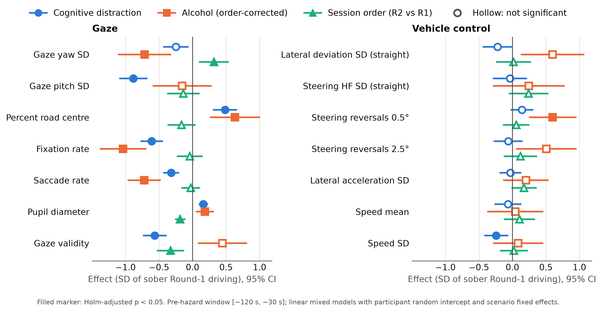

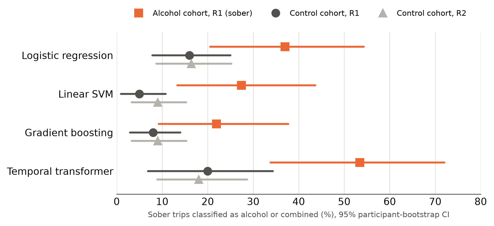

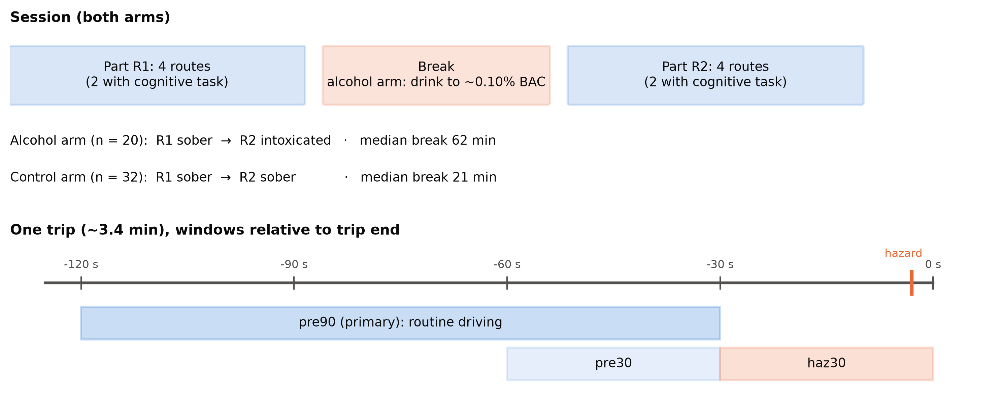

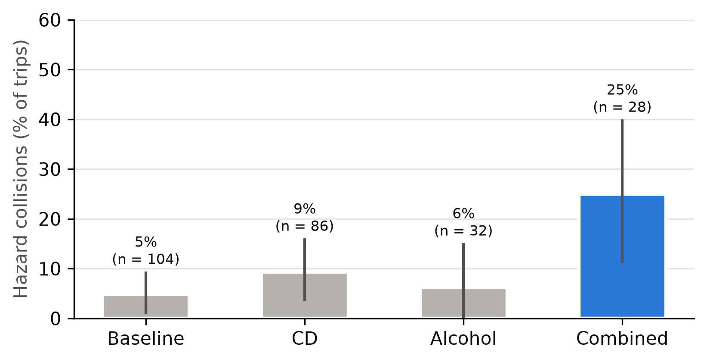

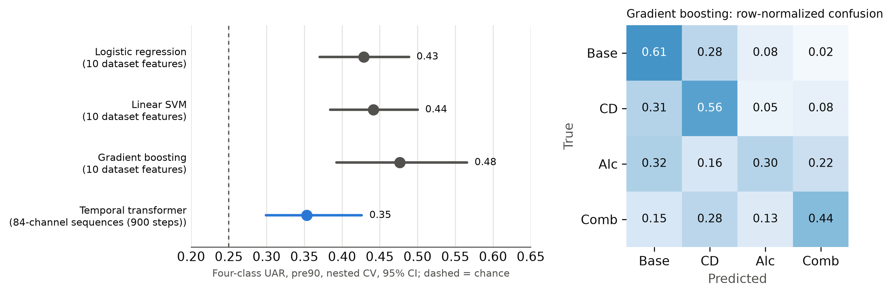

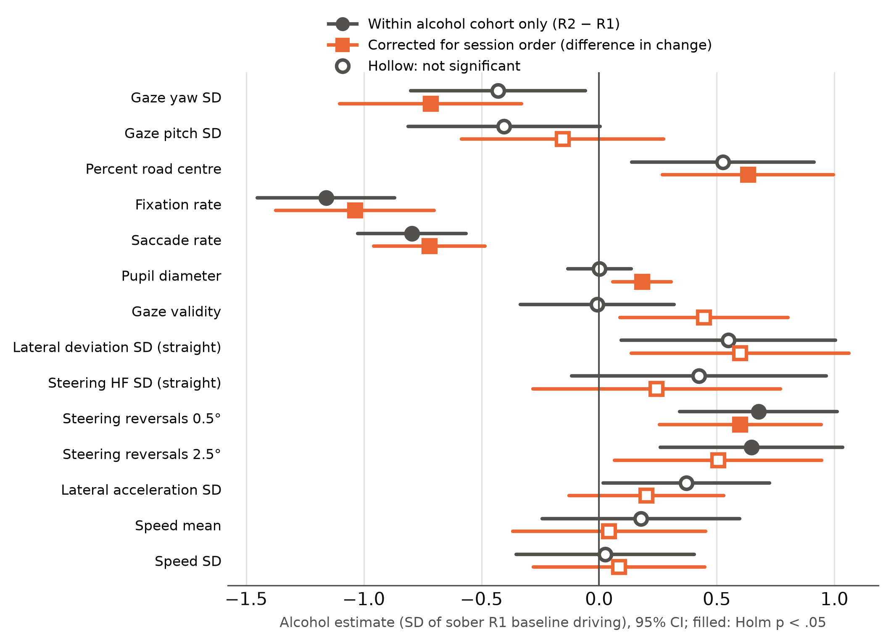

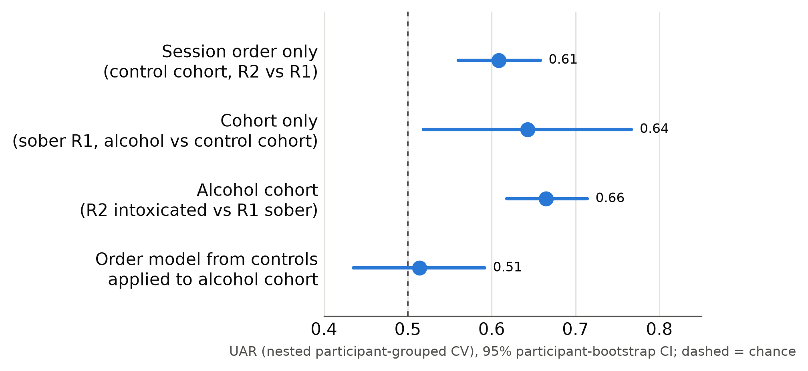

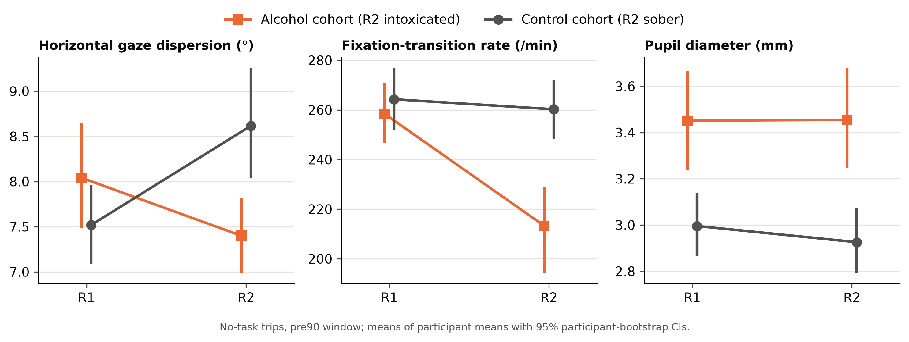

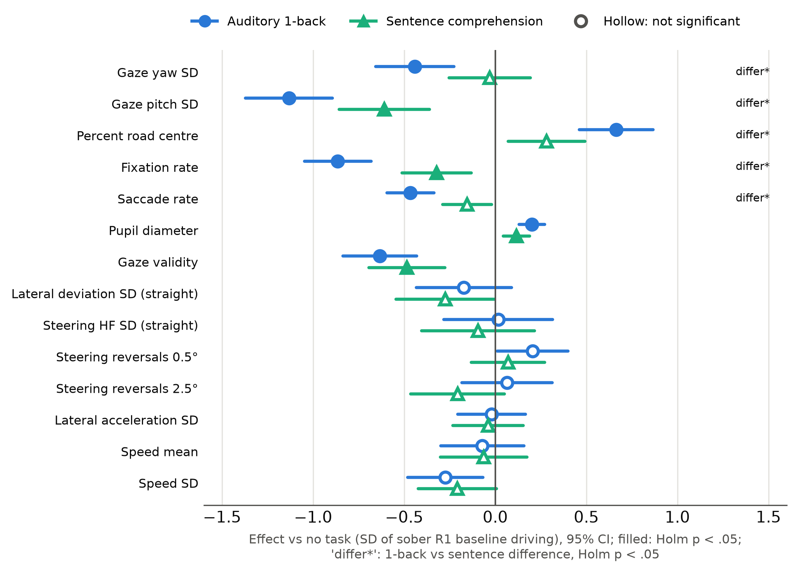

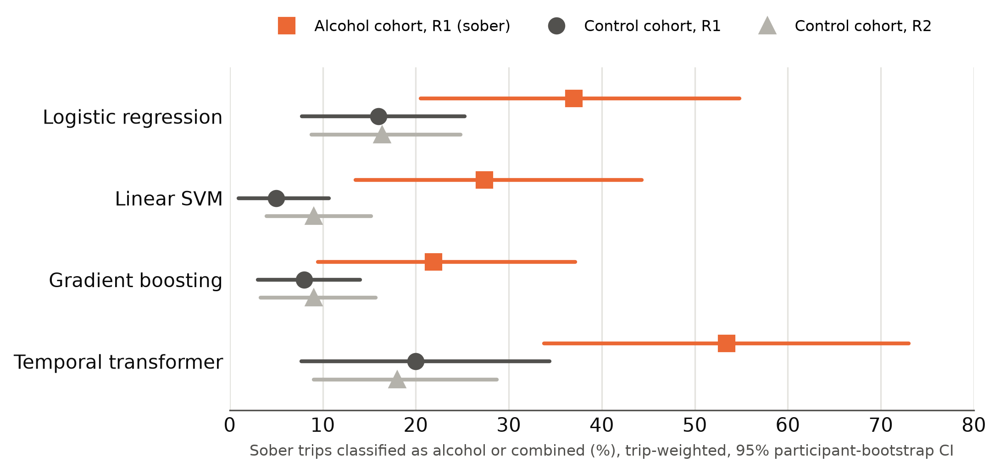

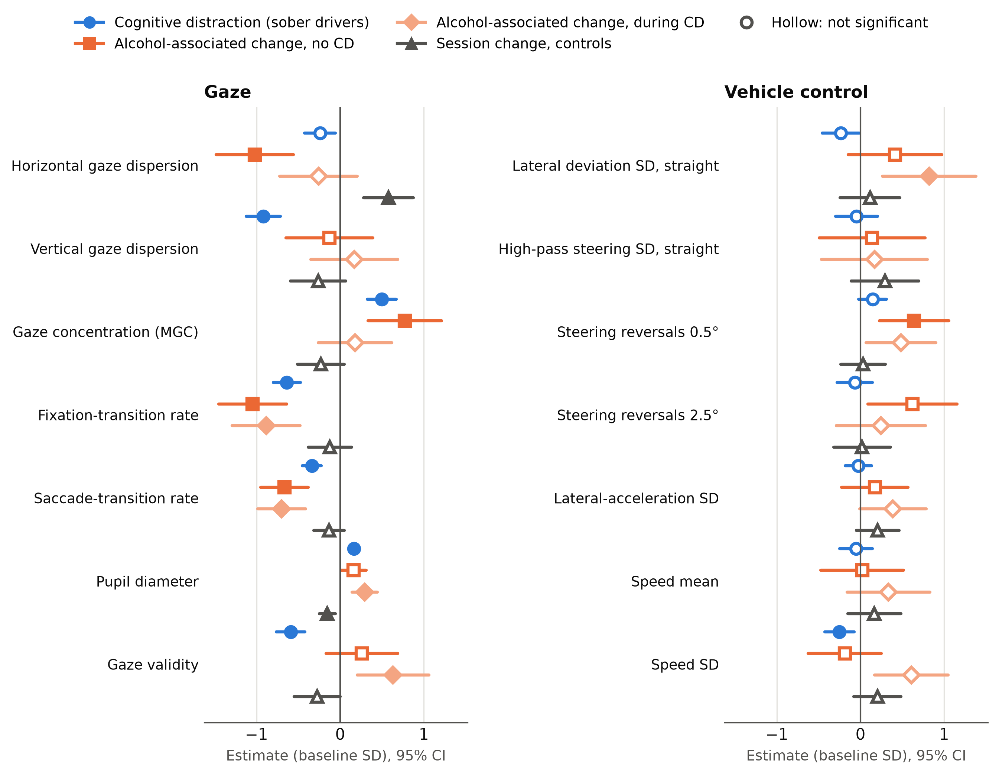

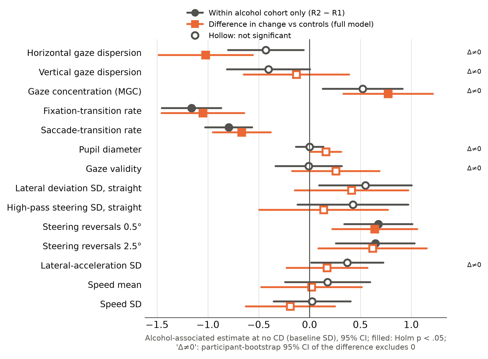

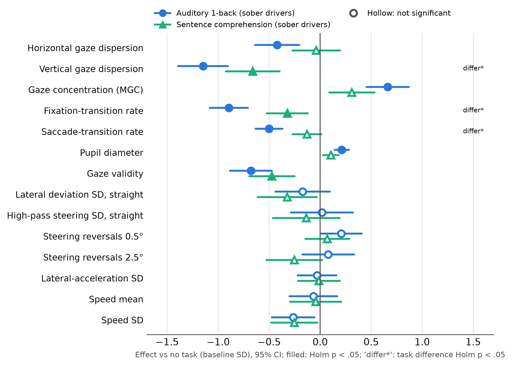

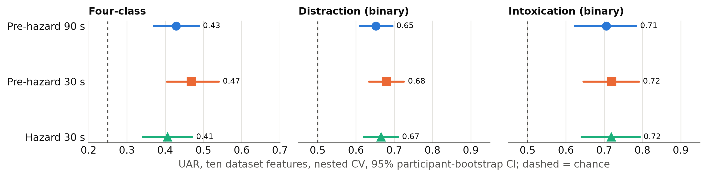

